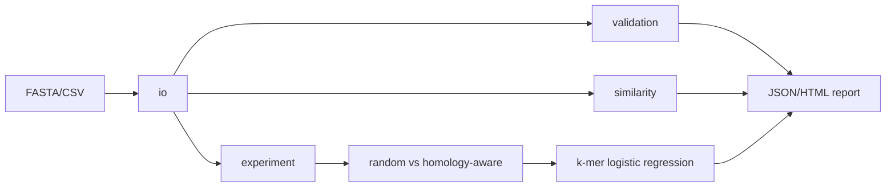

# BioAudit

**BioAudit** is a reproducible toolkit that audits protein sequence datasets for data quality and train/test similarity, then compares naive random splits with homology-aware splits using a lightweight baseline model.

> Research prototype, not a validated clinical or production tool. Built-in similarity is **k-mer Jaccard** (`kmer_jaccard`), not percent identity. Do not treat a hit as proof of leakage.

## Research question

How much can sequence similarity between training and test partitions inflate apparent model performance, and how can a researcher detect and reduce that risk?

## Features

- Protein FASTA (`.fa`, `.fasta`, `.faa`, `.fas`) and CSV ingestion
- Quality audit: empty sequences, unsupported symbols, duplicate IDs/sequences, length, labels
- Train/test similarity audit (`kmer_jaccard` or optional MMseqs2 identity)
- Random stratified vs homology-aware split comparison
- JSON plus standalone HTML reports (offline SVG charts, no JavaScript required)
- Provenance manifests for prepared datasets

## Architecture



## Installation

Python 3.10+.

Windows PowerShell:

```powershell
python -m venv .venv
.venv\Scripts\Activate.ps1
python -m pip install -e ".[dev]"
```

Linux/macOS:

```bash
python -m venv .venv
source .venv/bin/activate
python -m pip install -e ".[dev]"
```

```bash
python -m pytest
bioaudit --help
bioaudit --version
```

GitHub Actions workflow `.github/workflows/tests.yml` runs pytest on Python 3.10–3.12 (Ubuntu and Windows). Do not treat a badge as passing until that workflow has actually run on GitHub.

## Quick start

```bash
# Offline quality audit
bioaudit audit data/sample_proteins.fasta --out reports/sample

# Supervised toy fixture (synthetic; not a biological benchmark)
python scripts/prepare_dataset.py --source toy --out data/toy_classification.csv
bioaudit experiment configs/experiment.yaml --out reports/experiment_toy
```

Optional bounded UniProt download (demo ingestion only; not the classification benchmark):

```bash
python scripts/prepare_dataset.py --source uniprot --limit 1000 --out data/uniprot_human_reviewed.fasta
bioaudit audit data/uniprot_human_reviewed.fasta --out reports/uniprot
```

## CLI

```bash
bioaudit audit data/proteins.fasta --out reports/proteins
bioaudit audit data/proteins.csv --sequence-column sequence --label-column label --out reports/csv
bioaudit split-audit --train train.fasta --test test.fasta --backend kmer --threshold 0.7 --out reports/split
bioaudit split-audit --train train.fasta --test test.fasta --backend mmseqs --threshold 0.3 --out reports/mmseqs
bioaudit experiment configs/experiment.yaml --out reports/experiment_toy
bioaudit --version
```

Parent flags: `--verbose`, `--json` (print output paths as JSON), `--help`. Use `--no-overwrite` to refuse replacing existing report files. Default policy is to overwrite report paths and print the JSON/HTML locations.

The k-mer backend refuses pairwise scans above 250,000 train×test comparisons unless you pass `--allow-quadratic` or raise `--max-pairs`. `kmer_jaccard` is not sequence identity. See `docs/methodology.md`.

MMseqs2 must be installed separately and on PATH for `--backend mmseqs`.

## Dataset source, citation, and terms

| Dataset | Role | Terms |
| --- | --- | --- |
| `data/sample_proteins.fasta` | Offline smoke test | Synthetic; MIT project code |
| `data/toy_classification.csv` | Default experiment fixture | Synthetic labels/sequences; **not** a scientific benchmark |
| UniProtKB reviewed human proteins | Optional ingestion demo | [UniProt license](https://www.uniprot.org/help/license); not committed; not the supervised benchmark |

A public localization dataset (for example DeepLoc) was **not downloaded**. Confirm license and size before using one. Details: `data/README.md` and `docs/dataset_card.md`.

## Experiment (executed on the toy fixture)

Command:

```bash
python scripts/prepare_dataset.py --source toy --out data/toy_classification.csv
bioaudit experiment configs/experiment.yaml --out reports/experiment_toy
```

Executed locally on 21 synthetic sequences, 9 k-mer Jaccard clusters, character 3-mer logistic regression, seeds 0/1/2:

| Seed | Random macro-F1 | Homology-aware macro-F1 | Difference (pp) | Random test hit fraction | Homology-aware test hit fraction |
| --- | --- | --- | --- | --- | --- |
| 0 | 0.8222 | 0.0952 | 72.6984 | 0.85714 | 0.0 |
| 1 | 0.3571 | 0.3333 | 2.381 | 0.42857 | 0.0 |
| 2 | 0.4190 | 0.2222 | 19.6825 | 0.57143 | 0.0 |
| Mean |  |  | **31.5873** |  |  |

These numbers come from `reports/experiment_toy.json` after running the command above. They are **pipeline evidence on synthetic data**. They are not a protein biology result, not a claim about published papers, and not suitable for a resume bullet as a scientific finding. Homology-aware tests are small and sometimes drop a class because clusters of size 3 compete with a ~30% test budget.

A performance drop on a homology-aware split suggests reduced similarity-based shortcuts. It does not by itself prove that prior results are invalid.

## Protein alphabet policy

This release audits **protein** sequences only. After whitespace is removed and letters are uppercased:

| Symbols | Policy |
| --- | --- |
| `ACDEFGHIKLMNPQRSTVWY` | Canonical amino acids. No symbol warning. |
| `B J O U X Z` | Extended/ambiguous protein codes. **Accepted**, with an `extended_residue` warning. |
| `*` | Translation stop. **Kept**. `stop_symbol` warning; not called invalid. |
| `-` | Gap. **Kept**. `gap_symbol` warning; not called invalid. |
| Any other character | `unsupported_symbol` warning. The record is **not** removed. |

## Interpretation cautions

- High sequence similarity across train/test is a **risk indicator**, not proof that a reported result is invalid.
- Thresholds are task-dependent.
- Do not interpret a universal "reliability score". BioAudit reports component metrics.
- For large datasets, use MMseqs2 rather than the built-in quadratic k-mer scan.
- DNA/RNA, AnnData, and protein language models are out of scope for this release.

## Reproducibility

1. `python -m pip install -e ".[dev]"`
2. `python -m pytest` (offline; MMseqs2 integration skipped if `mmseqs` is absent)
3. `python scripts/prepare_dataset.py --source toy`
4. `bioaudit experiment configs/experiment.yaml`

Protocol: `docs/benchmark_protocol.md`. Reports include timestamps, config, and environment metadata.

## Roadmap

- [x] CI workflow for pytest on Python 3.10–3.12
- [x] Random vs homology-aware experiment (toy fixture)
- [x] Offline HTML charts
- [ ] MMseqs2 clustering-based split generation
- [ ] Licensed public localization benchmark (download not started)
- [ ] Optional protein language-model baseline
- [ ] AnnData / DNA / RNA modules

## License

MIT for this codebase. UniProt downloads remain subject to UniProt terms. Synthetic fixtures are not biological data.

## Citation

If you use BioAudit in research, cite this repository and any external dataset terms you downloaded (for example UniProt).
